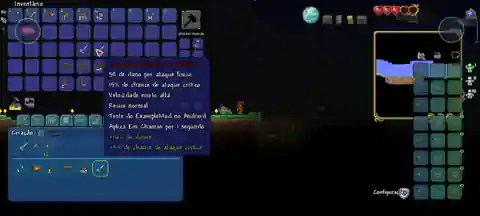
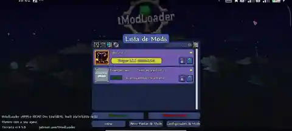
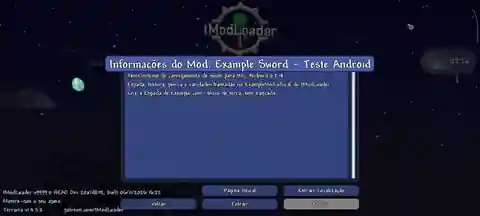

<div align="center">

# tModLoader Android

**An experimental, unofficial native ARM64 port of tModLoader for Android.**

The PC tModLoader C# runtime, adapted for a mobile display, touch input, Android lifecycle and performance — **without Windows or x86 emulation**.

[](https://github.com/MantovaniDevTrue/TmodLoader-Android/actions/workflows/mobile-net10.yml)
[](https://github.com/MantovaniDevTrue/TmodLoader-Android/actions/workflows/sdl-host.yml)

**.NET 10** · **Android ARM64** · **SDL3 + FNA** · **OpenGL (tested)** · **C# mods**

[Current status](docs/STATUS.md) · [Roadmap](docs/ROADMAP.md) · [Architecture](docs/ANDROID_PORT.md) · [Build instructions](docs/BUILD.md)

</div>

> [!IMPORTANT]
> **Experimental development project, not an official Terraria or tModLoader release.**
> The latest **phone-validated private APK is 0.2.17**. **0.2.18 is staged in source**, but has not been packaged and validated as a playable release. No playable public APK is provided here. You must own the matching Terraria PC **1.4.5.8** installation. Mod compatibility is **not universal or guaranteed**.

## What already works

- **Native ARM64 execution.** The tModLoader managed assemblies run through .NET 10 / Mono JIT on Android. The original Windows `Terraria.exe` is verified/imported as input, **not run by Wine, Box64 or an x86 emulator**.
- **Real game sessions.** The 0.2.17 OpenGL phone test entered a world, loaded the small `AndroidSwordTest` mod, saved the world and exited normally.
- **Android launcher.** Separate Home, Mods, Files, Settings and Diagnostics pages; local Terraria and `.tmod` importing, mod selection, PT-BR/English/Spanish launcher UI and TXT report export.
- **Game input adaptation.** Multi-touch routing through actual FNA input, configurable in-world controls and hardware input coexistence. Additional inventory gestures are staged for 0.2.18.
- **Diagnostics and measurements.** CPU frame timing, allocations, memory reporting and validation tests, without silently dropping shaders or mod hooks for benchmark scores.

## Screenshots from physical Android testing

These screenshots document experimental gameplay and the real tModLoader mod UI, **not** a finished mobile interface or broad third-party mod compatibility.

| Gameplay and inventory | Mod list |
| :---: | :---: |
|  |  |

<div align="center">



*Example Sword test-mod information shown in the in-game tModLoader UI.*

</div>

## Current development status

| Area | Status |
| --- | --- |
| Runtime | .NET 10, Android ARM64, Mono JIT |
| Renderer | OpenGL tested on physical device; Vulkan experimental |
| Latest phone-validated game build | **0.2.17** (private APK) |
| Next code milestone | **0.2.18** touch-first inventory candidate; **not released** |
| World entry, gameplay and saving | Validated in a real 0.2.17 session |
| Local C# `.tmod` loading | Validated with a **small example mod only** |
| Large PC mod compatibility | Unverified; individual mods may fail |
| Responsive crafting, mobile inventory UI and keyboard | In progress |

### Phone performance reference

The 0.2.17 OpenGL capture recorded median **56.5 presents/s** in the world, versus **48.3 presents/s** with inventory open. Draw CPU p95 was **20.7 ms** and **23.9 ms** respectively; total Android process PSS was approximately **2.29 GiB**. These are historical samples from one phone, **not** guarantees of 60 FPS or general device benchmarks. The main optimization targets are rendering sub-passes, inventory UI and GPU resource lifetime.

See [0.2.17 measurements](docs/releases/0.2.17.md), [performance methodology](docs/PERFORMANCE.md) and [current limitations](docs/STATUS.md).

## Project structure

| Directory | Purpose |
| --- | --- |
| `src/Tml.Game.Android/` | Android game host, launcher, runtime hooks and diagnostics |
| `src/Tml.GameIntegration/` | Integration built against the private game payload |
| `src/Tml.Mobile.Core/` | Shared input, mod-library and runtime utilities |
| `src/Tml.Mobile.Android/` | Standalone input/runtime diagnostic app |
| `integration/fna/` | Mobile modifications applied to the pinned FNA source |
| `integration/native/` | Android SDL3, FNA3D and FAudio native build |
| `integration/game/` | Managed game build integration |
| `tests/` | Input, FNA, host and performance regression checks |
| `tools/` | Build, verification, packaging and profiling scripts |
| `examples/AndroidSwordTest/` | Small mod used to validate local loading on-device |
| `docs/` | Architecture, device results, release notes and roadmap |

## Building from source

Requirements include the pinned **.NET 10 SDK**, Android workload, JDK 21, Android SDK/NDK, pinned upstream repositories and the relevant Android native dependencies.

```bash
dotnet workload install android --version 10.0.100

# Builds a diagnostic app, NOT a playable Terraria APK:
bash tools/build_mobile.sh \
  -p:AndroidSdkDirectory=/path/to/android-sdk \
  -p:JavaSdkDirectory=/path/to/jdk21
```

The **SDL game host** is tested by [GitHub Actions](.github/workflows/sdl-host.yml) without redistributing the game. A playable APK additionally requires privately generated tModLoader assemblies, the matching owned Terraria installation, Android libraries and signing. See [BUILD.md](docs/BUILD.md), [GAME_BUILD.md](docs/GAME_BUILD.md) and [SDL_HOST.md](docs/SDL_HOST.md).

> [!NOTE]
> Green source/host CI jobs **do not demonstrate** that an assembled game, every mod, Vulkan or a particular phone will work.

## Documentation and contribution

- [Current status](docs/STATUS.md), [changelog](CHANGELOG.md) and [per-version notes](docs/releases/)
- [Native mobile UX roadmap](docs/NATIVE_MOBILE_UX.md) and [mobile touch implementation](docs/MOBILE_TOUCH.md)
- [Architecture and delivery gates](docs/ANDROID_PORT.md)
- [Security policy](SECURITY.md), [credits and third-party licenses](THIRD_PARTY.md)
- [Contributing and bug reports](CONTRIBUTING.md)

If you report a bug, please include the Android model/OS, port version, renderer, active mods and relevant **sanitized** diagnostic log. Do not attach privately owned Terraria executables, game assets, signing keys or personal data.

## Credits and legal notice

This is an independent fan project maintained by **MantovaniDevTrue**, with credit to the original developers of [tModLoader](https://github.com/tModLoader/tModLoader), [Terraria / Re-Logic](https://terraria.org/), [FNA](https://github.com/FNA-XNA/FNA), [SDL](https://github.com/libsdl-org/SDL), FNA3D, FAudio, .NET and other upstream libraries. Their respective ownership and licenses remain in effect. No association with or endorsement by the official teams is implied.

**The repository does not provide proprietary game binaries, purchased game content, signing keys or personal save files.** See [THIRD_PARTY.md](THIRD_PARTY.md) and [SECURITY.md](SECURITY.md).
